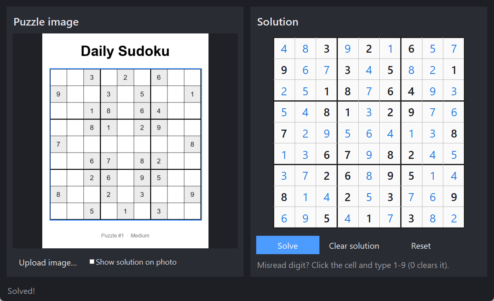

# Sudoku Solver

Upload a photo or screenshot of a Sudoku and get the solution. The puzzle is
found and read with OpenCV, solved with a backtracking search, and shown in a
Tkinter app: your image on the left, the solved grid on the right. The missing
digits can also be drawn back onto the original photo with the "Show solution
on photo" checkbox.



## Getting started

```bash
pip install -r requirements.txt
python main.py
```

Click **Upload image…** (or the empty image panel) and pick a picture. A couple
of samples are in [`samples/`](samples): a printable worksheet, a flat grid and
a tilted "phone photo".

The first launch takes a few seconds while the digit recogniser is trained;
after that it's cached and starts instantly.

## How it works

1. **Find the grid** – the image is blurred and adaptive-thresholded, and the
   largest four-cornered contour is taken as the board. Photos of a sheet of
   paper usually pick up the page edge first, so the solver straightens that
   region and looks again for a smaller grid inside it.
2. **Straighten it** – a perspective transform warps the board to a flat
   450×450 image, so every cell is a 50×50 square.
3. **Read the digits** – each cell is thresholded with Otsu, blobs touching the
   cell border (leftover grid lines) are flood-filled away, and the largest
   centred blob is taken as the digit. Cells without one are empty.
4. **Recognise them** – digits are centred and scaled into a 28×28 box, turned
   into HOG + downsampled pixel features, and classified with k-nearest
   neighbours. There's no downloaded model: training data is rendered from the
   fonts installed on your machine (plus OpenCV's Hershey fonts) with random
   rotation, scale, thickness and blur.
5. **Fix misreads with the rules** – a misread digit usually clashes with a
   correct one in the same row, column or box (a 6 read as an 8 next to a real
   8). When that happens, the classifier's runner-up guesses for the clashing
   cells are tried and the change that removes the clashes is kept.
6. **Solve** – backtracking with bitmasks for the row/column/box constraints,
   always branching on the cell with the fewest candidates. Even "the world's
   hardest Sudoku" solves in milliseconds.
7. **Overlay** – optionally, the solution is drawn on the flat grid and warped
   back onto the original photo with the inverse transform.

## Fixing misreads

OCR isn't perfect, especially with unusual fonts or blurry photos. If a digit is
read wrong, click the cell on the right and type the correct number
(`0`/`Backspace` clears it, arrow keys move around, `Enter` solves). Clashing
clues are highlighted in red.

## Project layout

```
main.py               entry point
sudoku/
  app.py              Tkinter UI
  vision.py           grid detection, warping, cell extraction, overlay
  ocr.py              synthetic training data, HOG features, k-NN classifier
  solver.py           backtracking solver
tools/make_sample.py  renders the sample worksheet, grid and fake "phone photo"
tests/                solver and end-to-end vision tests
```

## Tests

```bash
python -m unittest discover tests
```

## License

MIT
